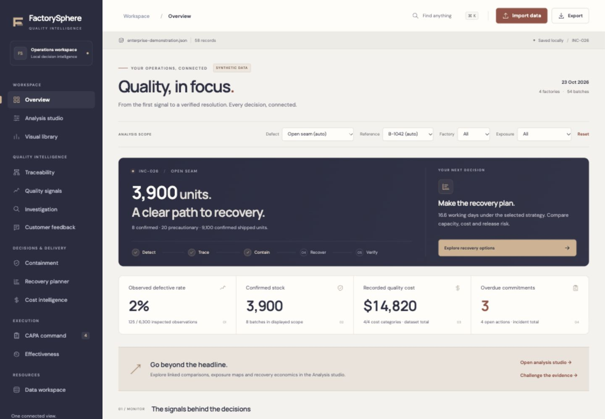

# FactorySphere

FactorySphere is a local-first browser app for apparel quality traceability, inspection analysis, exposure, recovery planning, Cost of Poor Quality, CAPA, and effectiveness verification. Uploaded data stays in the browser during local use.

Version 3 introduces a complete responsive product redesign, 13 connected workspaces, an interactive Analysis studio, 50 exportable visualizations, record search, evidence-linked investigation, seven recovery strategies, cost sensitivity and evidence-gated CAPA. [Implementation, formulas, requirements coverage and boundaries](TRANSFORMATION.md) and the [design system](DESIGN-SYSTEM.md) document the implementation.

**Release verification — 23 October 2026:** GitHub Pages deployment completed successfully from commit `3caeef5`. A live upload of `synthetic-product-mix.json` recalculated the dashboard to 110 defective observations / 2,000 inspected observations, persisted through reload, exposed the 8.2% vs 2.8% raw comparison, and produced the expected 5% vs 6% common-mix reversal in the decision report. Browser console warnings and errors were absent.

- Repository: https://github.com/mah-era/FactorySphere
- Live demo: https://mah-era.github.io/FactorySphere/

## Run locally

From this project directory:

    python3 scripts/serve_local.py

Open http://127.0.0.1:8765. Keep the terminal open while using the server. Stop it with Ctrl-C. The server sends no-cache headers, so reloading the page reads current app files. No LaunchAgent, background service, build, package installation, database, or internet connection is needed. The Excel reader is bundled locally in dist/vendor/.
An open tab checks the local build version when focused and periodically; it reloads after a local update so old analysis code does not keep showing outdated calculations.

## Upload your own data

Use **Import data** from any workspace. Uploads replace the active dataset and recalculate the dashboard, traceability, inspections, investigation comparisons, recovery estimates, costs, CAPA, verification, and reports. **Data workspace** shows source details and completeness. Download a workspace JSON snapshot to preserve edits and attached evidence before switching datasets. Other local tabs update to the same dataset. Browser IndexedDB retains the active dataset across reloads, including larger files; a storage warning appears if the browser cannot save it.

Supported inputs:

- One JSON file containing inspections and optional batches, shipments, complaints, actions, costInputs, recoveryInputs, and other related arrays. The included test JSON files show the full schema.
- One flat CSV/TSV/XLSX/XLS file with at least batch, sample, defects, and type columns. Common aliases such as batch_id, sample_size, defective_quantity, and defect_type work. Batch attributes on each row are used to infer production batches.
- Several related CSV/TSV/Excel files in one upload. Name them Inspections, Batches, Shipments, Complaints, Actions, and so on. Excel workbooks can use corresponding sheet names.

See dist/test-files/inspection-template.csv, examples/unseen-inspections.csv, and examples/unseen-multisheet.xlsx. The latter two are independent examples with defects and batches absent from the 20 prepared cases.

The minimum data gives inspection rates and a basic exposure classification. If both a result and acceptance threshold are missing, a 2.5% screening rule flags elevated records for review; those records remain precautionary until a reviewer records a Pass/Fail result with evidence or an approved threshold is supplied in the file. The Quality signals page has a review control for each inspection. Add SKU, factory, machine/line, material lots, stock, shipments, costs, and action records for stronger conclusions. Missing fields are shown as unavailable rather than filled from demo data. Sample size is never substituted for unknown production volume. Undated inspections cannot support time-based effectiveness verification. The app distinguishes confirmed evidence from precautionary links; a reviewer decides root cause and final disposition.
Dates should use `YYYY-MM-DD`; day/month/year is also accepted and interpreted day first when ambiguous. Add `accepted_units` per batch to calculate cost per acceptable garment. Shipped quantities can be read from shipment records when the batch table omits them.

## Twenty test cases

dist/test-files/ contains 20 synthetic JSON scenarios and scenarios.zip. Select one in **Data workspace → Scenario library** and click **Load case**, or upload its JSON file. Scenarios cover shared material controls, different causes of the same defect, incomplete inspections, delayed complaints, capacity bottlenecks, cost tradeoffs, weak corrective actions, and missing closure evidence. **Load multi-factory demonstration** opens an additional illustrative case with 54 batches, 58 inspection records and four factories.

## Workflows

- Choose a defect and reference batch; inspect product genealogy and scope rationale.
- Filter the dashboard by factory and exposure classification.
- Add inspections and review customer complaint records.
- Compare defect patterns by machine, material lot, line, thread, shift, and team; record an evidence-backed cause and reviewer.
- Adjust inspection and rework capacity; compare seven recovery strategies when confirmed and related stock quantities are complete. Edit approval/material lead times, working calendars, reinspection/packing rates, machine/skill availability, costs and inspection-risk assumptions. View sequential stage timelines, full/priority completion, delay, uninspected related units and units before cut-off.
- Enter prevention, appraisal, internal failure, external failure, recurrence, and reduction assumptions; review COPQ and expected prevention return.
- Maintain containment, CAPA ownership, approval, evidence, and 30/60/90-day verification. Record a corrective action completion date, a separate date and evidence reference for each later check, and post-action inspection evidence. Closure is blocked until required gates pass and the observed defect rate improves without a recorded negative effect.
- Download an HTML report or CSV export calculated from the active file and selected defect focus, including exposure, inspections, cost categories, recovery alternatives, verification checks, CAPA actions, and audit events.
- Review statistical control limits, process concentration, severity weighting, factory/style comparisons and an explainable signal register.
- Record hypotheses, fishbone categories and Five Whys; classify customer feedback with reviewer/evidence; maintain containment commitments.
- Assign RACI roles and acyclic action dependencies. Record named approval evidence and an independent effectiveness reviewer before closure.
- Compare recurrence sensitivity, break-even probability and payback from explicit incident frequency. Attribute cost entries to orders, defects, factories and suppliers.
- Attach PNG/JPEG/WebP/PDF evidence locally, export analytical JSON, or transfer the complete workspace between browsers using a JSON snapshot.

## Visual outputs

The **Analysis studio** links factory, line, style, inspection-stage, machine, material and shift comparisons to their underlying inspections. Filter the quality lens by factory, stage, dates and minimum group sample; select a group to update its metrics, activity heatmap and evidence table. Export the current selection to CSV. Other lenses explicitly retain portfolio-wide or incident-wide scope.

The studio also includes a clickable inventory area map, a defect-signature matrix, interactive recovery cost/time selection, a sequential recovery timeline, signed prevention-benefit sensitivity, action evidence matrices, and deadline-distance charts. The dashboard's inventory tiles link directly to batch genealogy.

Choose **Analysis studio → Critical decision review** to challenge the conclusions. It detects incomplete or screening evidence, competing passing controls, composition-confounded comparisons and ranking reversals. Recovery plans are checked for dominance across cost, time, containment coverage and modeled risk. A 5×5 recurrence/reduction stress matrix shows when prevention creates a net benefit or net cost. Findings include the reason, supporting records and the next verification step. Complete HTML, CSV and analytical JSON exports retain the decision-review outputs.

For a known-answer example, upload [the supplemental synthetic product-mix dataset](dist/test-files/synthetic-product-mix.json). Factory A has a raw 8.2% rate versus B's 2.8%; standardizing the observed style mix reverses that comparison to 5% versus 6%. The app should explicitly flag that reversal. This extra example is separate from the original 20 scenario files.

The **Visual library** contains 50 data-driven charts in addition to the dashboard and studio compositions. Filter by workspace or search chart titles and explanations. Each chart provides source/date, units, assumptions, exact values on hover, an expandable evidence table, standalone SVG download and chart CSV download. Operational pages separate **Workspace** and **Visual analysis** tabs; switching tabs preserves unsubmitted fields.

Coverage includes factory/line/stage/team rates with confidence intervals, inspection volumes, severity burden, stock/shipment exposure, machine/material/shift comparisons, complaints, containment, recovery cost-time trade-offs and cost bridges, inspection risk, release quantities, attributable COPQ, intervention comparisons, CAPA workload/deadlines/evidence, matched effectiveness and data completeness. Missing inputs produce explicit unavailable states.

Use **Export → Visual report** for a self-contained HTML collection of all 50 charts, suitable for browser printing to PDF. **Export → Decision report** includes the charts alongside the detailed decision report. Chart scope and source are stated on every output; chart CSV retains full numerical precision. Reports use the same ink, ivory, slate, sand and clay design language.

## Navigation and responsive experience

- Press **⌘K / Ctrl+K** or choose the search icon to find a workspace, batch, inspection or action in the active dataset.
- Open the navigation drawer on tablet and mobile; **Escape** dismisses it. Keyboard focus stays inside the open drawer.
- Use **Jump to** on operational workspaces to reach a section directly. Long record tables include a local text filter.
- The interface adapts to desktop, tablet and mobile. Wide analytical charts and tables scroll inside their own panels.
- Typography is self-hosted: DM Sans and Manrope, with their SIL Open Font Licenses in `dist/fonts/`. No remote font or chart request is required.

## Validation commands

    node scripts/validate-data.mjs
    node scripts/validate-scenarios.mjs
    node scripts/validate-local.mjs
    node scripts/validate-intelligence.mjs
    node scripts/validate-visuals.mjs
    node scripts/validate-experience.mjs

Validation covers all 20 scenarios, the extended demonstration, independent calculation oracles, unseen JSON, flat CSV, related CSV tables, explorer filter intersections, signed chart domains, proportional inventory areas and safe rendering. Browser checks cover all 13 workspaces at 1440, 768 and 390 pixels, independent CSV/XLSX/JSON uploads, linked filtering, saved edits, reload, evidence-gated closure and downloaded reports. See [the redesign verification log](DESIGN-SYSTEM.md#verification-record) for the observed results.

## Operational limits

This is a browser-local decision-support application. It does not synchronize users, authenticate approvals, integrate ERP/inspection systems, or optimize a minute-by-minute factory dispatch schedule. The recovery model uses explicit capacity and cost assumptions. Tabular input files are limited to 20 MB combined and JSON snapshots to 50 MB; evidence attachments are limited to 2 MB each and 20 MB combined. Local records and audit history are mutable. A multi-user enterprise deployment requires authenticated access, server-side workflow enforcement, a database, durable evidence retention, backups and operational integrations. See [TRANSFORMATION.md](TRANSFORMATION.md) for the complete requirements and assurance matrix.

## Development and deployment

The runtime is buildless HTML, CSS and ES modules in `dist/`, with a bundled Excel parser and no external chart or font requests. The Python server is a loopback-only static server. Node is required only for development validation and synthetic-data generation.

On a push to `main`, `.github/workflows/pages.yml` runs the validation suites and publishes `dist/` to GitHub Pages. Localhost and the hosted site maintain separate browser storage. No production data are stored in the repository; the included datasets are synthetic.
